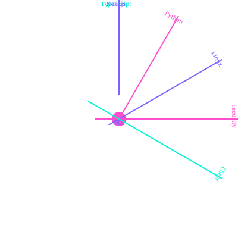

<div align="center">


<a href="https://github.com/Vrindaverse">
  
</a>

<br/>


</div>


## 🛰️ TRANSMISSION

<div align="center">

</div>


## 🪐 MY ORBIT

<div align="center">

</div>


## ⚔️ LOADOUT

<div align="center">


</div>


## 🎬 FEATURED MISSIONS

<div align="center">

<a href="https://github.com/Vrindaverse/VisualBase"></a>
<a href="https://github.com/Vrindaverse/Commit"></a>
<a href="https://github.com/Vrindaverse/zaimori"></a>
<a href="https://github.com/Vrindaverse/Vrindaverse"></a>

</div>


## 🐍 THE CONTRIBUTION GRID

<div align="center">

<picture>
  <source media="(prefers-color-scheme: dark)" srcset="https://raw.githubusercontent.com/Vrindaverse/Vrindaverse/output/github-snake-dark.svg" />
  <source media="(prefers-color-scheme: light)" srcset="https://raw.githubusercontent.com/Vrindaverse/Vrindaverse/output/github-snake.svg" />
  
</picture>

</div>


## 📡 TELEMETRY

<div align="center">


</div>


## 🎯 CURRENT QUEST LOG

- 🔨 **Building:** full-stack projects, with an obsession for UI/UX
- 🧠 **Exploring:** AI/ML and emerging tech
- 🛡️ **Training:** cybersecurity and pentesting tools, on Arch
- ♟️ **Grinding:** chess openings I'll forget by move 12
- ✍️ **Writing:** stories, because code isn't the only way to build worlds


## 🧩 EASTER EGGS

```text
♟️  I read code like a chess game: openings, middlegames, endgames.
🐧  Arch is my daily driver. Yes, I'll tell you about it.
📖  Anime + storytelling = most of my side-quest ideas.
🌙  Best commits happen after midnight. Not a recommendation.
```


<div align="center">

### 📬 OPEN CHANNEL

<a href="https://github.com/Vrindaverse"></a>
<!-- <a href="https://linkedin.com/in/YOUR-ID"></a> -->
<!-- <a href="mailto:YOUR-EMAIL"></a> -->

<br/>

*"Small, useful work over vague claims."*


</div>
