

  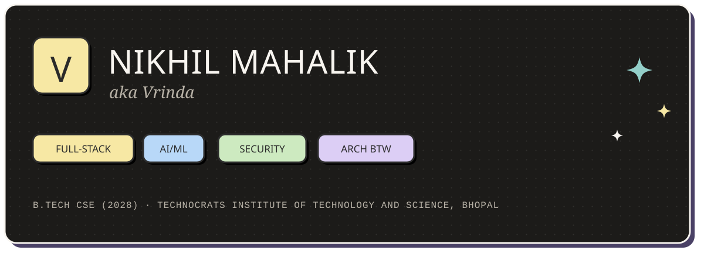

  <b>Full-stack developer</b> · building calm interfaces and systems that hold up · <b>open to tech and HR internships</b>

 

  

I build across the stack — React and Next.js on the front, Python and Node on the back — with a growing focus on AI/ML and security. I care about interfaces that feel quiet, and systems that stay correct under pressure.

Currently building **ANANTA**, a persistent-world pixel RPG. Previously led people and culture as **Vice President, People Management at AIESEC in Bhopal**.

Off-screen: chess, creative writing, Hindi literature, and Indian culture.

  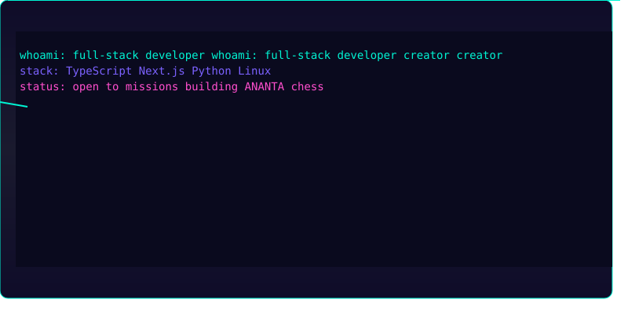

  

  

  <a href="https://github.com/Vrindaverse/Ananta">
    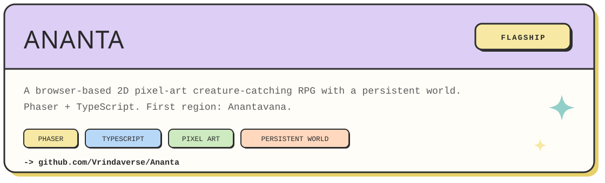
  </a>

<table align="center">
  <tr>
    <td width="50%">
      <a href="https://commit-ivory.vercel.app">
        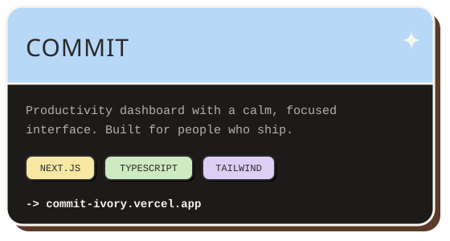
      </a>
    </td>
    <td width="50%">
      <a href="https://github.com/Vrindaverse/TDC">
        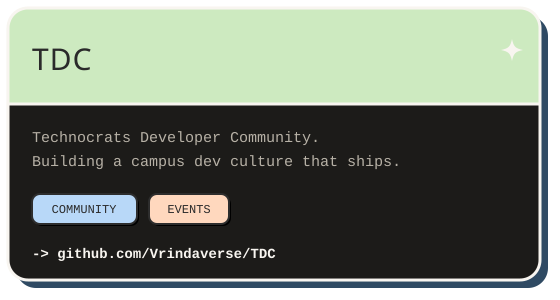
      </a>
    </td>
  </tr>
  <tr>
    <td width="50%">
      <a href="https://github.com/Vrindaverse/VisualBase">
        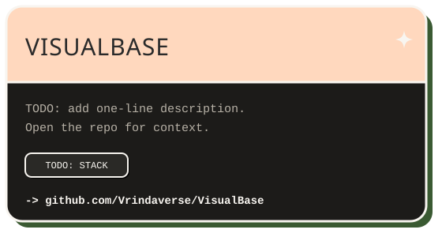
      </a>
    </td>
    <td width="50%">
      <a href="https://github.com/Vrindaverse/zaimori">
        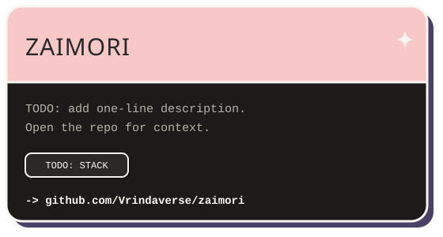
      </a>
    </td>
  </tr>
</table>

<!-- TODO: verify repo slugs and descriptions with `gh repo list Vrindaverse` after authenticating. VisualBase and zaimori descriptions are intentionally placeholders. -->

  

  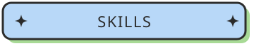

  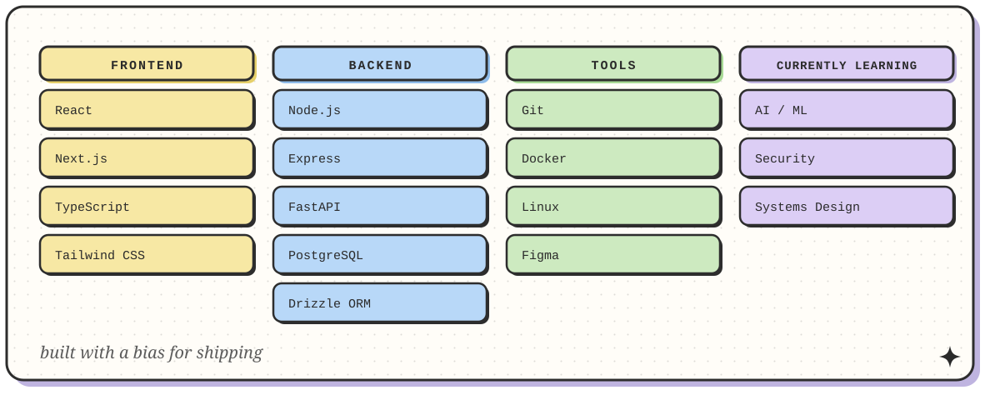

  

  

**Vice President, People Management — AIESEC in Bhopal.** Led people operations and engagement across the local committee: building teams, running skill-building sessions, and keeping the culture human while the work stayed ambitious.

  

  

  
  
   
  

  <picture>
    <source media="(prefers-color-scheme: dark)" srcset="https://raw.githubusercontent.com/Vrindaverse/Vrindaverse/output/github-snake-dark.svg" />
    <source media="(prefers-color-scheme: light)" srcset="https://raw.githubusercontent.com/Vrindaverse/Vrindaverse/output/github-snake.svg" />
    
  </picture>

<!-- Fallback metrics card, generated by .github/workflows/stats.yml. Run the workflow once so this file exists. -->

  

  

  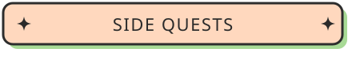

- **Chess** — openings, middlegames, and the occasional brilliant blunder.
- **Creative writing** — stories, because code isn't the only way to build worlds.
- **Hindi literature** — poetry and prose that reward slowing down.
- **Indian culture** — the references, rituals, and ideas I keep coming back to.

> छाया में नीम की तरह, कोड में तर्क की तरह।
>
> *Like neem in the shade, like logic in the code.*

  

  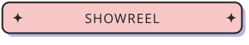

  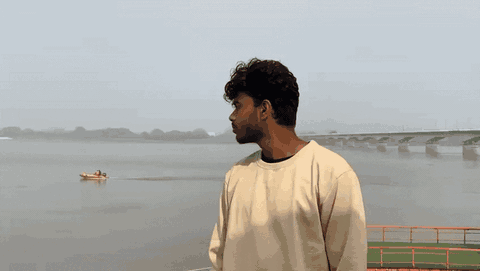

  

  

  
  <!-- TODO: replace with your LinkedIn URL -->
  
  <!-- TODO: replace with your email address -->
  

 

  Built with ivory, ink, and hard shadows.

